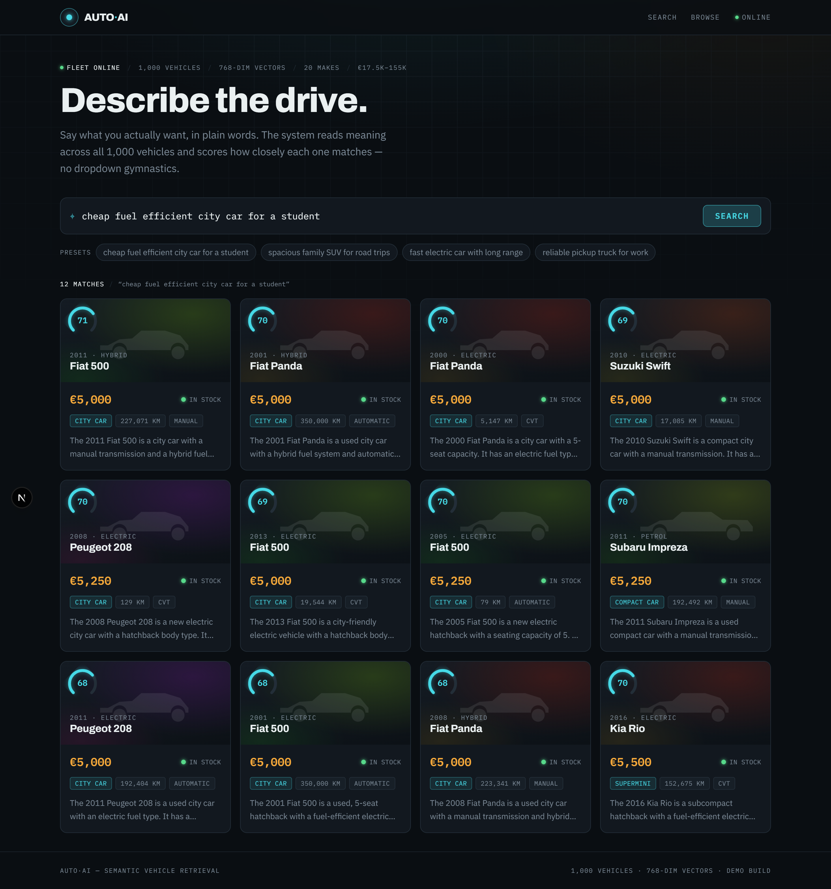
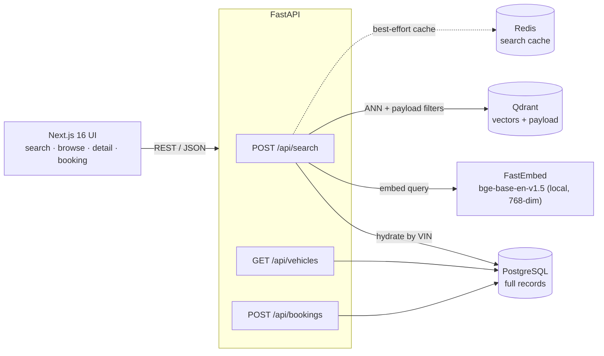
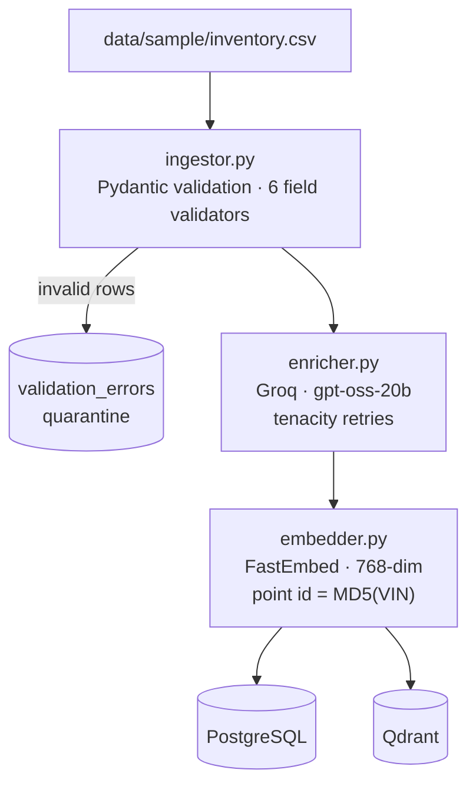
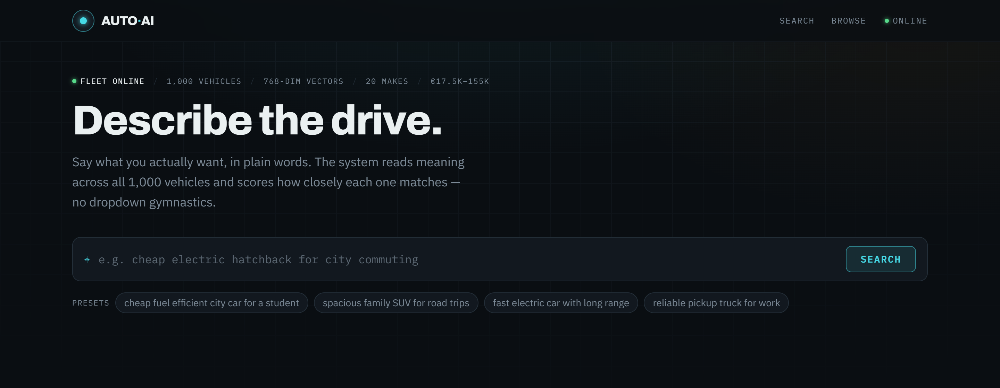
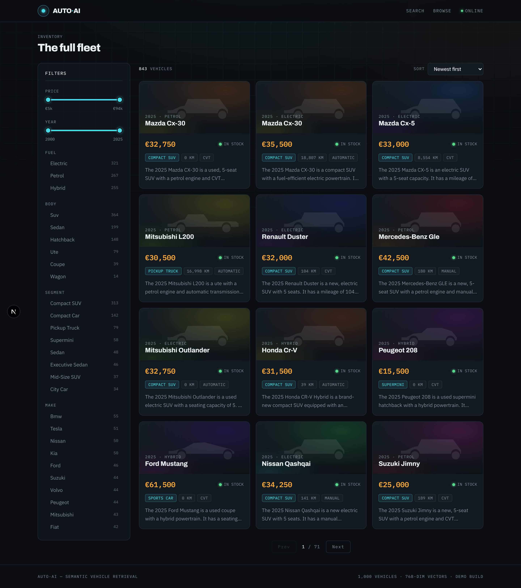
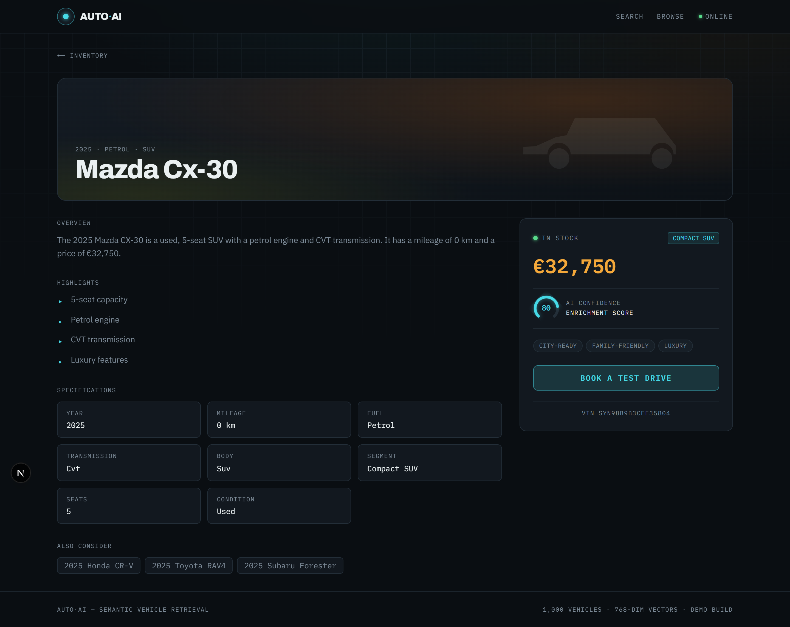
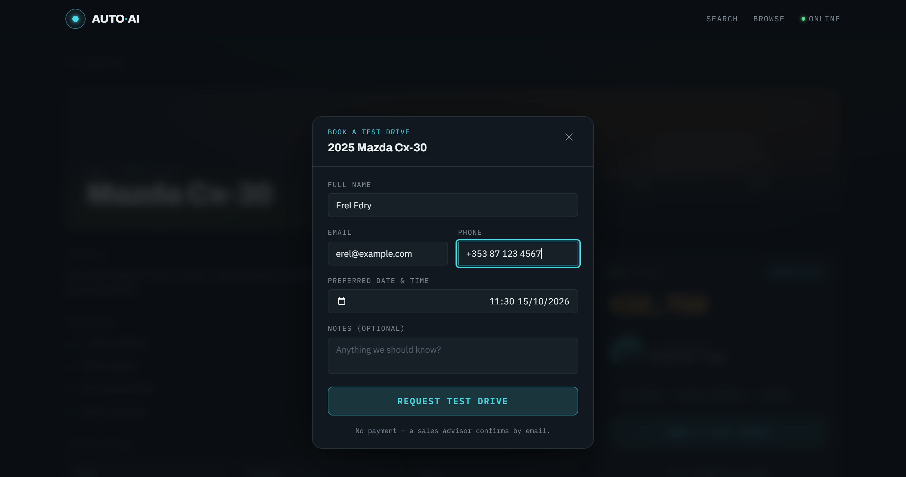

# AUTO·AI — Semantic Car Dealership

**Describe a car in plain English; an AI-enriched RAG pipeline finds it and reports how closely each vehicle matches.**

Not a filter-dropdown car site — you *talk* to it (*"cheap fuel-efficient city car for a student"*, *"family SUV between €30k and €40k"*) and it retrieves by **meaning**, ranks results, and shows a per-vehicle match score. A full-stack, end-to-end system: a validated data pipeline enriches 1,000 vehicles with an LLM, embeds them into a vector store, and serves them through a semantic-search API and a bespoke Next.js UI.

<p align="center">
  
</p>

<p align="center">
  
  
  
  
  
  
  
</p>

---

## Highlights

- **Semantic search over meaning, not keywords** — queries are embedded locally and matched by cosine similarity in Qdrant, with structured payload filters applied in the same round trip.
- **Natural-language budget intent** — *"cheap"*, *"luxury"*, *"under €20k"*, *"between 30k and 40k"* are parsed into hard price filters + a soft ordering preference. The displayed match % stays the **semantic** score, so the gauge never lies.
- **LLM enrichment pipeline** — each vehicle gets an AI summary, lifestyle tags, a canonical body segment, selling points, comparables, and a confidence score, all schema-validated.
- **Idempotent, multi-store data ops** — deterministic per-vehicle functions keep PostgreSQL, the Qdrant payload, and the source CSV in sync; re-runs never duplicate or drift, and only new vehicles spend LLM tokens.
- **Bespoke "Night-Drive HMI" UI** — a dark automotive-instrument aesthetic with a match-score gauge, per-body-type car silhouettes, live range filters, and a working test-drive booking flow.
- **Measured, not just built** — a retrieval eval harness scores precision@k / recall@k / MRR / nDCG on a labelled query set and shows the hybrid rerank beats pure ANN.
- **Tested + CI** — 202 unit tests (pytest) and a GitHub Actions pipeline (ruff + pytest + frontend build).

---

## Architecture



**Semantic search flow:** embed the query locally → filtered ANN search inside Qdrant (one round trip) → hydrate full records from PostgreSQL in relevance order → hybrid lexical rerank + budget-intent ordering → cache in Redis (best-effort; a Redis outage never breaks search).

---

## The data pipeline



- **Validation with quarantine** — bad rows are routed to a `validation_errors` table, never silently dropped.
- **Incremental re-runs** — a per-vehicle content hash skips unchanged rows and resyncs changed ones without calling the LLM; an embedding failure leaves the vehicle queued for the next run instead of half-written.
- **Deterministic vector IDs** — Qdrant point ID = `MD5(VIN)`, so re-embedding *updates* a point instead of orphaning the old one (Python's `hash()` is per-process randomised — a real footgun this avoids).
- **Canonical segments** — free-text LLM output is snapped onto a fixed 18-value vocabulary (17 segments + `Other`) so `ai_segment` works as a filter facet.

---

## Tech stack

| Layer | Choice | Why |
|---|---|---|
| API | **FastAPI** (async) | typed, fast, first-class Pydantic |
| Vector DB | **Qdrant** | payload filters + ANN in one round trip |
| Relational | **PostgreSQL 16** + Alembic | source of truth; migration-managed schema |
| Cache | **Redis 7** | best-effort search cache (300s TTL) |
| Embeddings | **FastEmbed** · `bge-base-en-v1.5` | **local, no API key**, reproducible, free |
| Enrichment | **Groq** · `gpt-oss-20b` | fast JSON-mode LLM, free tier |
| Frontend | **Next.js 16 · React 19 · Tailwind v4** | App Router, SSR detail pages, typed client |
| Infra | **Docker Compose** | one-command full stack: UI, API, data stores |
| Quality | **pytest · ruff · GitHub Actions** | unit tests + lint + build on every push |

---

## Screenshots

| Search | Browse |
|---|---|
|  |  |
| Natural-language search box with preset queries. | Facet sidebar + live price/year range sliders. |

| Detail | Book a test drive |
|---|---|
|  |  |
| Spec sheet, AI summary, confidence gauge. | Booking flow: 404 unknown car, 409 sold or slot taken (enforced by a DB unique index, so concurrent requests can't double-book), 422 invalid input or past time (any timezone). |

*The gauge on each card is the semantic match %; the tiles use per-body-type car silhouettes since the sample data has no image URLs.*

---

## Quickstart

**Prerequisites:** Docker Desktop (Node 20+ only for frontend hot-reload).

```bash
# 1. Whole stack — API, PostgreSQL, Redis, Qdrant, and the Next.js UI
cp .env.example .env          # set POSTGRES_PASSWORD; GROQ_API_KEY is needed for enrichment
docker compose up -d          # builds the web image on first run; the api applies
                              # Alembic migrations (alembic upgrade head) on start
curl http://localhost:8000/health

# 2. Populate the inventory (validate → enrich → embed)
docker compose exec api python -m app.etl.pipeline      # or --limit 10 to sample
```

Open **http://localhost:3000**.

<details><summary>Frontend hot-reload (development)</summary>

```bash
docker compose stop web                     # free port 3000
cd frontend && npm install && npm run dev
```
</details>

**Interfaces:** UI `:3000` · API docs `:8000/docs` · Qdrant dashboard `:6333/dashboard` · pgAdmin `:5050`

Try a search: *"cheap fuel efficient city car for a student"*, *"luxury electric SUV"*, or *"family SUV between 30k and 40k"*.

**Optional settings** (`.env`): `ADMIN_TOKEN` enables the admin-only booking
listing (`GET /api/bookings` with header `X-Admin-Token`); `CORS_ORIGINS` lists
the browser origins allowed to call the API (comma-separated); `DEBUG=true`
logs every SQL query.

<details><summary>Upgrading an existing install (data from before the review fixes)</summary>

A fresh install needs none of this. On a stack that already holds data, run
once after pulling:

```bash
docker compose up -d --build --force-recreate api   # applies migration 002 on start
docker compose exec api alembic current             # expect: 002 (head)

# Restore make/model casing (Bmw → BMW, Rav4 → RAV4) in PostgreSQL, the Qdrant
# payload and the AI text; also adds the make_key the search filter now uses.
docker compose exec api python -m scripts.fix_name_casing           # dry run
docker compose exec api python -m scripts.fix_name_casing --apply

# The change-detection hash now covers every spec field, so the first run
# resyncs every vehicle: local re-embed, no LLM calls, a few minutes.
docker compose exec api python -m app.etl.pipeline
```

- **Migration 002** converts booking times to `timestamptz` and adds a unique
  index (one active booking per vehicle + slot) and a foreign key to the
  inventory. It stops with an error if existing bookings already break either
  rule; fix those rows by hand, then restart the `api` container.
- Until `fix_name_casing --apply` has run, filtering search by make returns
  nothing, because existing Qdrant points have no `make_key` yet.
- Bookings made before the fix were stored as the browser's local time labelled
  UTC; there is no way to tell which rows are affected, so they are left as-is.
</details>

---

## Testing & CI

```bash
docker compose exec api sh -c "pip install -r requirements-dev.txt && pytest"
```

**202 unit tests** cover the logic that carries real risk (no DB/network needed):
budget-intent parsing, lexical rerank, segment normalisation, the deterministic
pricing model, the ingestion/booking validators, the ETL pipeline's skip /
resync / quarantine decisions, and the search/vehicles/bookings routes against
stubbed stores. The pure query helpers were extracted into
`app/core/query_intent.py` specifically so they're testable without pulling in
the embedding model. One more test (`test_booking_race.py`) fires concurrent
bookings at a real PostgreSQL; it runs only when `TEST_DATABASE_URL` is set.

> These tests caught a real bug — `"no more than 30k"` was also setting a *lower*
> bound (the `over` pattern's `"more than"` matched inside it), fixed with a
> lookbehind.

**CI** (`.github/workflows/ci.yml`) runs on every push/PR: `ruff` + `pytest`
(backend) and `npm run build` (frontend).

---

## Retrieval evaluation

A harness (`backend/eval/`) scores the search endpoint on a labelled query set
and compares **pure vector search (ANN)** against the **hybrid lexical rerank**.
Relevance is predicate-based — a result counts as relevant if its
segment/body/fuel is in the query's allowed set and its price is within the
stated band — a scalable, explainable proxy for human judgment, evaluated over
available stock (18 queries, k=10). *Measured before the lexical-rerank and
budget-word fixes; re-run to refresh.*

| | P@5 | P@10 | R@10 | MRR | nDCG@10 |
|---|---|---|---|---|---|
| ANN only | 0.844 | 0.789 | 0.227 | 0.944 | 0.832 |
| **Hybrid rerank** | **0.911** | **0.844** | **0.234** | **1.000** | **0.893** |
| Δ | +0.067 | +0.056 | +0.007 | +0.056 | +0.061 |

The bounded lexical rerank improves every metric and lifts MRR to a perfect
1.000 (the top result is always relevant). Recall@10 is low by construction —
several categories have 300+ relevant vehicles, so k=10 captures only a slice.

```bash
docker compose exec api python -m eval.run_eval --detail
```

---

## Key technical decisions

- **Local embeddings over an API.** FastEmbed runs `bge-base-en-v1.5` in-container — no key, no per-call cost, deterministic, and works offline. bge is asymmetric, so queries get the retrieval instruction (`query_embed`) while documents are stored as plain passages.
- **Filter inside Qdrant, hydrate from Postgres.** One vector round trip with payload filters (make/fuel/body/segment/seats/stock/price/year; make matches case-insensitively via a normalised `make_key`); PostgreSQL is only touched to hydrate full records by VIN. Keeps latency down and each store doing what it's best at. The blocking work (ONNX inference, the sync Qdrant client) runs in worker threads, so a search never stalls other requests.
- **Hybrid rerank as a seam.** A bounded, dependency-free lexical bonus (≤0.10) for whole-token hits on make/model (and, more weakly, segment/body/fuel/tags) lifts exact matches above near-tied cosine scores — and marks the exact spot to drop in a cross-encoder/Cohere reranker later.
- **Budget intent that keeps the gauge honest.** NL price cues become a hard Qdrant filter (explicit amounts) or a soft price preference (qualitative words); numbers that are specs, not prices (*"50,000 km"*, *"2018 to 2022"*, *"7 seats"*), are ignored. The preference reorders results but the *displayed* score stays the pure semantic relevance.
- **Determinism for idempotent, multi-store writes.** Vector IDs and stock status are pure functions of the VIN, and price is a pure function of the vehicle's row, so PostgreSQL + Qdrant + CSV can be updated independently and always agree; data scripts and migrations are safe to re-run.
- **Incremental, token-frugal pipeline.** A content hash over every spec field decides per vehicle: unchanged → skip; changed → resync from the stored AI fields with a local re-embed (no LLM call); only new or unindexed vehicles spend Groq tokens. Invalid rows are quarantined, never dropped.
- **Invariants in the database, not just the handler.** A partial unique index guarantees one active booking per vehicle and slot even under concurrent requests (one gets 201, the other 409), and appointments are stored as `timestamptz`.
- **Buyer-facing schema.** `VehicleOut` deliberately omits `acquisition_cost` (the dealer's buy-in), so internal margin never leaks to the client.

---

## Project structure

```
dealership-project/
├─ backend/
│  ├─ app/
│  │  ├─ api/routes/       search.py · vehicles.py · bookings.py
│  │  ├─ core/             config · database · cache · segments · query_intent
│  │  ├─ etl/              ingestor · enricher · embedder · pipeline
│  │  ├─ models/           SQLAlchemy models
│  │  └─ schemas/          Pydantic schemas
│  ├─ scripts/             idempotent data migrations (prices, stock, segments, names)
│  ├─ eval/                retrieval eval harness (precision@k / MRR / nDCG)
│  ├─ tests/               202 unit tests (pytest) + 1 opt-in DB test
│  └─ alembic/             schema migrations
├─ frontend/               Next.js 16 app (App Router, TypeScript) + Dockerfile
├─ docs/                screenshots · SESSION_LOG.md (build history)
├─ docker-compose.yml
└─ .github/workflows/ci.yml
```

---

## Roadmap

- **Neural reranking** — swap the bounded lexical bonus for a cross-encoder / Cohere reranker at the existing seam, then re-run the eval harness to quantify the lift.
- **API integration tests** — extend CI beyond unit tests to exercise the endpoints against an ephemeral Postgres/Qdrant.

> This is a portfolio project built to demonstrate end-to-end data-engineering, retrieval/ML, and full-stack work. The inventory is synthetic; prices and enrichment are generated.
